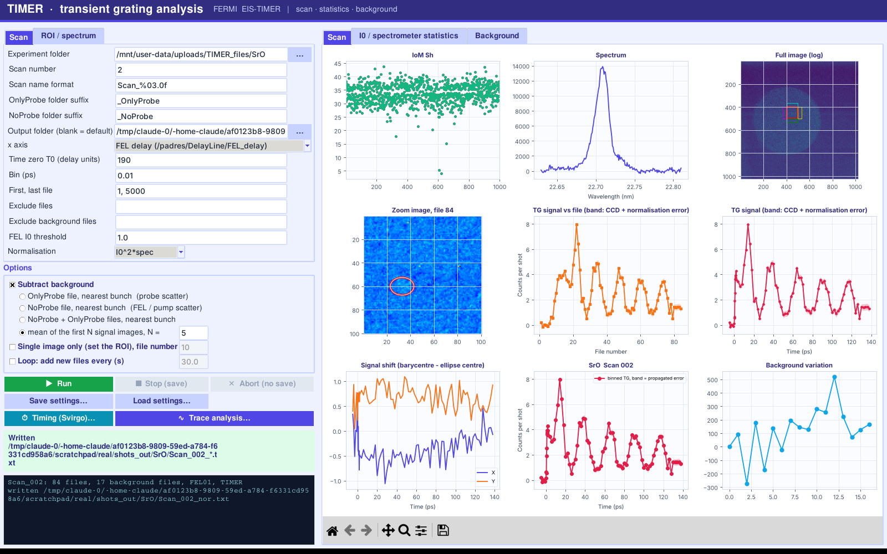
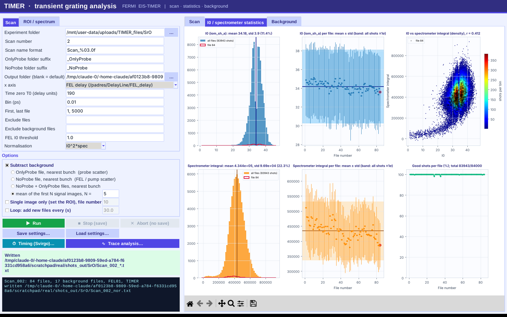
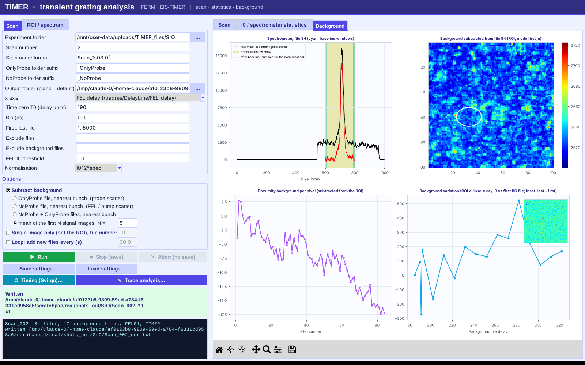
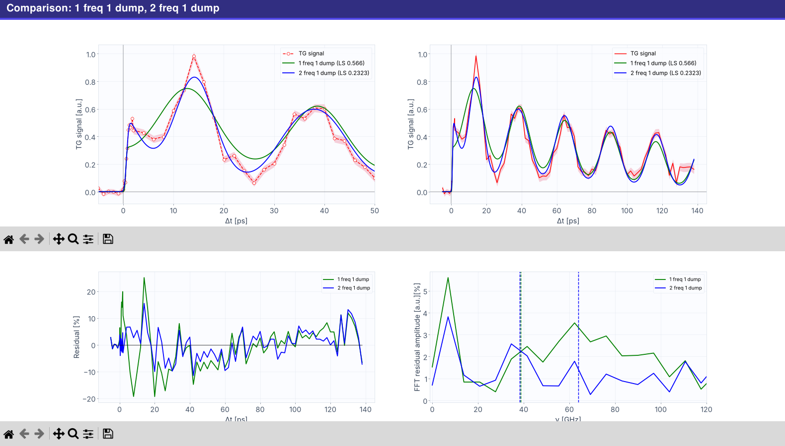
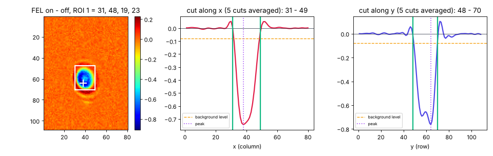

# TIMER GUI

Python analysis software for the **EIS-TIMER** transient-grating beamline at the FERMI free-electron
laser (Elettra, Trieste). One window replaces the three tools we used before: the MATLAB scan
analysis (`AnalisiMaxiTimer200505*.m`), the Svirgo pump-timing script (`Svirgo_comparison.m`) and
the trace-fitting notebook.

It reads the beamline's HDF5 files and writes the same `Scan_NNN_raw/_nor/_pos/_bg/_MNF.txt` output
as the MATLAB code (checked identical on STO Scan_008 and SrO Scan_002), and adds propagated error
bars, live shot statistics, an automatic ROI finder for timing and 1 to 3 frequency global fits.



## What it does

- **Scan analysis**: ROI and ellipse integration of the CCD images, I0 and spectrometer
  normalisation (I0³, I0²·spectrum or I0·spectrum), four background-subtraction modes (OnlyProbe,
  NoProbe, both, or the mean of the first N images), binning against FEL delay, delay lines, phase
  shifters or M2Z, and a loop mode that follows a scan while it is being recorded.
- **Statistics and background tabs**: I0 and spectrometer histograms, per-file stability, I0 vs
  spectrometer correlation, the subtracted background and the proximity background per file.
- **Error bands**: pixel noise, background and photon shot noise propagated per file and through
  normalisation and binning, written to `Scan_NNN_err.txt`.
- **Timing (Svirgo) window**: pump A / pump B timing by cross-correlation, with 1 or 2 ROIs
  (Wollaston prism), drawn by hand or found automatically on the FEL-on minus FEL-off image.
- **Trace analysis window**: thermal decay plus 1, 2 or 3 damped acoustic frequencies, FFT of the
  residual with Lorentzian fits, uneven time steps, and editable guesses and bounds.

| Statistics | Background |
|---|---|
|  |  |
| **Trace fit** | **Timing, automatic ROI** |
|  |  |

## Install and run

You need **Python 3.9 or newer** with numpy, scipy, matplotlib and h5py (all included in Anaconda)
and Tkinter. `tabulate` is optional and gives nicer fit tables.

```bash
git clone https://github.com/D3nFaina/timer-gui.git
cd timer-gui
pip install -r requirements.txt        # or: conda env create -f environment.yml && conda activate timer
python timer_gui.py
```

Other ways to start it:

- **Spyder**: open `timer_gui.py` and press Run (F5). If Spyder complains about the event loop,
  choose Run > Configuration per file > *Execute in a dedicated console*.
- **Windows**: double-click `start_timer_gui.bat` (edit the Anaconda path inside if it is not in
  `%USERPROFILE%\anaconda3`).
- **Linux / macOS**: `./start_timer_gui.sh`.

Keep all the `.py` files in the same folder. The last settings are remembered in
`~/.timer_gui_settings.json`, and *Save/Load settings* keeps one file per sample.

## First scan

1. Experiment folder: the sample folder that contains `Scan_NNN/rawdata/*.h5`.
2. Scan number, T0, ROI, ellipse and spectrometer window, as in the MATLAB input block.
3. Tick *Subtract background* and pick a mode.
4. Press **Run**. Tick *Loop* to keep adding files while the scan runs. **Stop (save)** finishes
   the current file and saves; **Abort (no save)** writes nothing.
5. Results go to `<parent of experiment folder>/results/OutPut/<sample>/` unless you choose another
   output folder.

## Documentation

- [docs/USER_GUIDE.md](docs/USER_GUIDE.md): what every box and button does.
- [docs/TIMER_guide.pdf](docs/TIMER_guide.pdf): an illustrated walk-through of a real scan, from
  start to fitted trace, and the comparison with MATLAB.
- [INSTALL_BEAMLINE.txt](INSTALL_BEAMLINE.txt): short install notes for the beamline PC.

## Files

| File | What it does |
|---|---|
| `timer_gui.py` | The GUI; this is the file you run |
| `timer_analysis.py` | Scan analysis engine: ROI, ellipse, normalisation, binning, errors, output |
| `timer_io.py` | HDF5 loading: images, I0, spectrometer, background by bunch number |
| `timer_timing.py` | Svirgo pump A / pump B timing |
| `trace_fit.py` | Thermal decay, FFT and Lorentzians, 1/2/3-frequency global fits |

## Author

Danny Fainozzi, University of Bern ([website](https://d3nfaina.github.io)).
